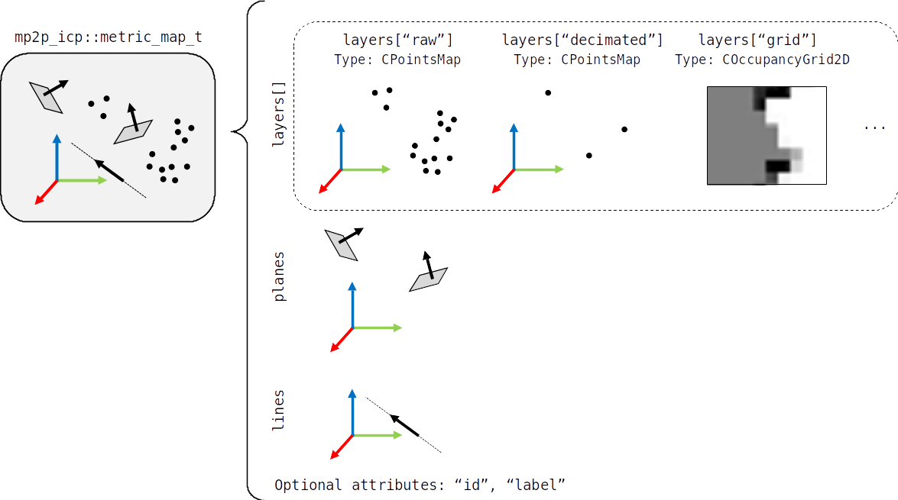
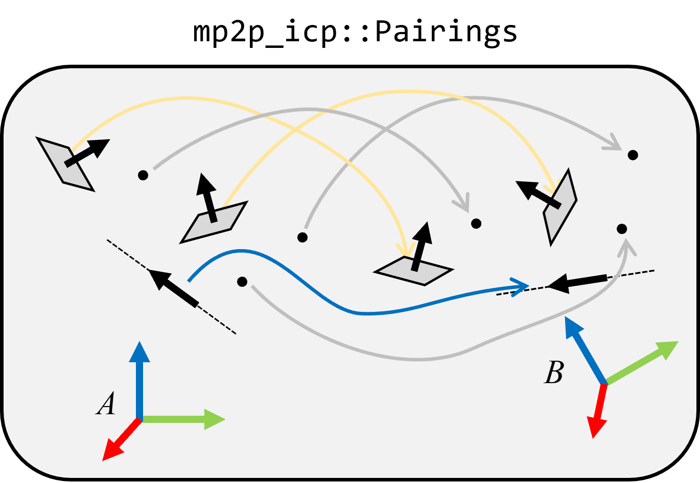

.. _mp2p_icp_basics:

=================
Basics
=================

1. Data structures
####################

Metric maps: point clouds, and more
---------------------------------------

The basic data class is ``metric_map_t``. It comprises:

  - A set of **map layers**, each one an instance of a generic `mrpt::maps::CMetricMap <https://docs.mrpt.org/reference/stable/class_mrpt_maps_CMetricMap.html>`_, typically point clouds (`mrpt::maps::CGenericPointsMap <https://docs.mrpt.org/reference/stable/class_mrpt_maps_CGenericPointsMap.html>` or `mrpt::maps::CSimplePointsMap <https://docs.mrpt.org/reference/stable/class_mrpt_maps_CSimplePointsMap.html>`_) but may hold also 2D grid maps (`mrpt::maps::COccupancyGridMap2D <https://docs.mrpt.org/reference/stable/class_mrpt_maps_COccupancyGridMap2D.html>`_) or 3D octomaps (`mrpt::maps::COctoMap <https://docs.mrpt.org/reference/stable/class_mrpt_maps_COctoMap.html>`_). Layers are indexed by a **name** (``std::string``).

  - Other geometric entities: lines, planes.

Pairings
-------------

Simple-maps
---------------------------------------
Simplemaps are key frame-based maps. Each key-frame contains a SE(3) pose (optionally, including uncertainty)
along with raw sensor observations gathered from that pose, and optional metadata. An example of standardized metadata
is the local frame velocity at the moment of recording the sensor data, including a small window of IMU raw readings, essential to perform accurate motion compensation.

Although the corresponding C++ class 
(`mrpt::maps::CSimpleMap <https://docs.mrpt.org/reference/stable/class_mrpt_maps_CSimpleMap.html>`_) 
is defined in the MRPT project,
we enumerate it here as it is a fundamental data structure for this package and the whole MOLA framework.

2. Algorithms
##################

``mp2p_icp::ICP`` aligns a **local** metric map to a **global** one, given an initial guess,
by repeating these steps until the pose correction falls below ``minAbsStep_trans`` and
``minAbsStep_rot``, or ``maxIterations`` is reached:

1. **Matchers** pair geometric entities of the local map with those of the global map,
   layer by layer, using the current pose estimate. For example:
   ``Matcher_Points_DistanceThreshold`` (point-to-point, within a distance),
   ``Matcher_Point2Plane`` and ``Matcher_Point2Line``, ``Matcher_Cov2Cov``
   (Generalized ICP, with the local covariance of each point),
   ``Matcher_Points_InlierRatio``, or ``Matcher_Adaptive``.
2. A **solver** finds the optimal transformation for all those pairings:
   ``Solver_GaussNewton`` (all kinds of pairings, robust kernels, optional prior),
   ``Solver_Horn`` or ``Solver_OLAE``. See :ref:`optimal-transformations`.
   Several solvers may be given: the first one that succeeds is used, so each one can be
   restricted to some iterations or pairing types.

At the end, **quality evaluators** score the result in [0,1], e.g. ``QualityEvaluator_PairedRatio``
(ratio of paired points), ``QualityEvaluator_Voxels`` or ``QualityEvaluator_RangeImageSimilarity``.
With several of them, their weighted mean is reported.

Before ICP, :ref:`filters <mp2p_icp_filters>` prepare the layers to match (decimation, de-skew,
range limits, ...). Run ``mola-cli --rtti-children-of mp2p_icp::Matcher`` (or ``Solver``,
``QualityEvaluator``) to list the classes available in your installation.

.. _mp2p_icp_yaml_pipelines:

3. YAML pipeline definition files
###################################

An ICP pipeline is defined in a YAML file, loaded with ``mp2p_icp::icp_pipeline_from_yaml()``
(this is what :ref:`icp-run <app_icp-run>` and MOLA-LO do). Every stage is a sequence of
``class`` / ``params`` entries:

.. code-block:: yaml

    class_name: mp2p_icp::ICP

    # Parameters of the ICP loop (mp2p_icp::Parameters):
    params:
      maxIterations: 100
      minAbsStep_trans: 1e-4
      minAbsStep_rot: 1e-4

    solvers:
      - class: mp2p_icp::Solver_GaussNewton
        params:
          maxIterations: 2

    matchers:
      - class: mp2p_icp::Matcher_Points_DistanceThreshold
        params:
          threshold: 0.50
          # Which global map layer is paired with which local map layer:
          pointLayerMatches:
            - {global: "raw", local: "decimated"}

    quality:
      - class: mp2p_icp::QualityEvaluator_PairedRatio
        params:
          threshold: 0.10

    # Optional filter pipelines, applied to each map before ICP:
    filters_local_map:
      - class_name: mp2p_icp_filters::FilterDecimateVoxels
        params:
          output_pointcloud_layer: 'decimated'
          voxel_filter_resolution: 0.10  # [m]

The parameters of each class are listed in its :doc:`C++ API reference <doxygen-index>`, and the
filters in :ref:`mp2p_icp_filters`. Complete examples are the ``icp-settings-*.yaml`` files in the
`demos directory <https://github.com/MOLAorg/mp2p_icp/tree/develop/mp2p_icp_core/demos>`_, and the
ICP blocks of the :ref:`MOLA-LO pipelines <mola_lo_pipelines>`. Numeric parameters may be given as
formulas of variables provided at run time (e.g. ``"max(0.2, 2*ICP_ITERATION)"``), and the files are
pre-processed for ``${VAR|default}`` variables (see :ref:`yaml_variables`).

